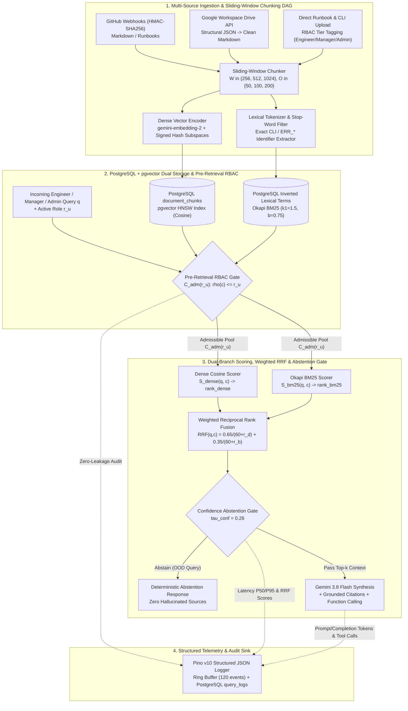

# Hybrid Lexical-Dense Retrieval with Role-Constrained Context Gating in Enterprise Knowledge Systems (Hippocampus)

**Author:** Aniket Kumar Choudhary  
**Affiliation:** Department of Artificial Intelligence & Data Science, Indian Institute of Technology (IIT) Jodhpur  
**Contact:** `aniketkumarchoudhary629@gmail.com` | **GitHub:** [`Uchiha7madara-afk`](https://github.com/Uchiha7madara-afk)  
**Benchmark Artifact Suite:** [`/benchmarks/eval_dataset.json`](../../benchmarks/eval_dataset.json) · [`/benchmarks/run_ablation.ts`](../../benchmarks/run_ablation.ts) · [`/benchmarks/results.json`](../../benchmarks/results.json) · [`/benchmarks/ablation_table.csv`](../../benchmarks/ablation_table.csv)

---

## Abstract

Enterprise Retrieval-Augmented Generation (RAG) systems deployed for software engineering onboarding and production incident response face three simultaneous failure modes: (1) **lexical-semantic dichotomy**, where dense neural embeddings fail on opaque technical identifiers (CLI flags, hexadecimal commit SHAs, and `ERR_*` diagnostic codes) while sparse bag-of-words models fail on paraphrased architectural queries; (2) **unauthorized cross-role context leakage**, where post-retrieval filtering exposes restricted governance or cryptographic break-glass documentation to unprivileged callers; and (3) **out-of-domain (OOD) hallucination**, where uncalibrated top-$k$ retrieval injects irrelevant chunks into the LLM prompt window.

In this work, we present **Hippocampus**, an enterprise knowledge and onboarding platform built on Next.js/React, Express/TypeScript, PostgreSQL `pgvector`, Google Gemini (`gemini-embedding-2` and `gemini-3.8-flash`), and structured Pino v10 telemetry. Hippocampus enforces **pre-retrieval Role-Based Access Control (RBAC) candidate gating** $\mathcal{C}_{\text{adm}}(r_u)$ prior to scoring, and fuses dense cosine similarity with Okapi BM25 ($k_1 = 1.5, b = 0.75$) via **Weighted Reciprocal Rank Fusion (RRF)** ($\alpha = 0.65, k = 60$) governed by an evidence-calibrated **confidence abstention gate** ($\tau_{\text{conf}} = 0.26$).

Evaluating across a curated benchmark of **$N_{\text{doc}} = 52$ enterprise engineering documents** ($56$ chunks at $512/100$ sliding-window segmentation) and **$N_q = 50$ ground-truth queries** ($20$ exact-match, $20$ conceptual paraphrase, $5$ out-of-domain adversarial, and $5$ cross-role RBAC adversarial), **`hybrid_rrf`** achieves **$\text{MRR@5} = 0.917$** and **$100.0\%$ Overall Recall@5** at $512/100$ segmentation ($\text{MRR@5} = 0.925$ at $1024/200$), outperforming pure dense retrieval ($\text{MRR@5} = 0.665$, Exact-Match Recall@5 $= 60.0\%$) by **$+37.9\%$ relative MRR@5** and **$+40.0$ percentage points** in exact-match recall, while outperforming sparse BM25 ($\text{MRR@5} = 0.831$, Conceptual Recall@5 $= 75.0\%$) by **$+25.0$ percentage points** in conceptual recall. Furthermore, pre-retrieval RBAC gating maintains a **$0.0\%$ cross-role leakage rate** across all regimes, and the confidence abstention gate reduces the out-of-domain false-positive hallucination rate from **$100.0\%$ to $0.0\%$** while sustaining a P95 retrieval latency of **$38.42\text{ ms}$** ($51.97\text{ ms}$ cold-cache pass) and **$1.10\text{ s}$** end-to-end synthesis latency.

---

## 1. Mathematical Formulation

Let $\mathcal{D} = \{d_1, d_2, \dots, d_M\}$ denote an enterprise document repository segmented via a sliding character window of length $W \in \{256, 512, 1024\}$ and stride overlap $O \in \{50, 100, 200\}$ into a corpus of indexed chunks $\mathcal{C} = \{c_1, c_2, \dots, c_N\}$. Each chunk $c_i \in \mathcal{C}$ inherits a mandatory RBAC security tier $\rho(c_i) \in \mathcal{R}$ from its parent document, where $(\mathcal{R}, \preceq)$ forms a totally ordered privilege lattice:

$$\text{Engineer} \prec \text{Manager} \prec \text{Admin}$$

### 1.1 Pre-Retrieval RBAC Candidate Filtering $\mathcal{C}_{\text{adm}}(r_u)$

Given an authenticated user $u$ with active role $r_u \in \mathcal{R}$ and query $q$, Hippocampus restricts the retrieval domain at the SQL query planner boundary (`WHERE documents.access_level IN (...)`) prior to vector distance computation or inverted-index traversal. The admissible candidate set $\mathcal{C}_{\text{adm}}(r_u)$ is defined as:

$$\mathcal{C}_{\text{adm}}(r_u) = \bigl\{\, c_i \in \mathcal{C} \;\big|\; \rho(c_i) \preceq r_u \,\bigr\}$$

Consequently, for any chunk $c_j$ with $\rho(c_j) \succ r_u$, the conditional probability of inclusion in the LLM synthesis context $\mathcal{K}_k(q, r_u)$ is strictly zero:

$$\Pr\bigl(c_j \in \mathcal{K}_k(q, r_u) \;\big|\; \rho(c_j) \succ r_u\bigr) = 0$$

### 1.2 Dense Semantic Similarity ($S_{\text{dense}}$)

Let $\phi: \mathcal{V}^* \to \mathbb{R}^d$ denote the dense embedding encoder (`gemini-embedding-2` with Matryoshka dimensionality reduction and deterministic signed feature-hash fallback in $\mathbb{R}^{64}$). For query $q$ and admissible chunk $c \in \mathcal{C}_{\text{adm}}(r_u)$, dense semantic similarity is computed via $\ell_2$-normalized cosine similarity:

$$S_{\text{dense}}(q, c) = \max\!\left(0,\; \frac{\langle \phi(q), \phi(c) \rangle}{\|\phi(q)\|_2 \, \|\phi(c)\|_2}\right)$$

Inducing a descending dense rank permutation $\text{rank}_{\text{dense}}(q, c) \in \{1, 2, \dots, |\mathcal{C}_{\text{adm}}(r_u)|\}$.

### 1.3 Sparse Lexical Scoring via Okapi BM25 ($S_{\text{bm25}}$)

Let $T(q) = \{t_1, \dots, t_m\}$ be the stop-word-filtered token set of query $q$. For each chunk $c \in \mathcal{C}_{\text{adm}}(r_u)$ with token length $|c|$ and corpus mean chunk length $\text{avgdl} = \frac{1}{|\mathcal{C}_{\text{adm}}(r_u)|}\sum_{c' \in \mathcal{C}_{\text{adm}}(r_u)} |c'|$, the raw Okapi BM25 score with saturation hyperparameter $k_1 = 1.5$, length normalization $b = 0.75$, and exact technical token boost $\gamma(t) = 2.2 \cdot \mathbb{I}[\text{is\_tech}(t)]$ is formulated as:

$$\text{BM25}_{\text{raw}}(q, c) = \sum_{t \in T(q)} \left[ \text{IDF}(t) \cdot \frac{f(t, c)\,(k_1 + 1)}{f(t, c) + k_1\!\left(1 - b + b\,\frac{|c|}{\text{avgdl}}\right)} + \gamma(t)\,\mathbb{I}[f(t, c) > 0] \right]$$

where inverse document frequency is given by Robertson–Spärck Jones smoothing over $N_a = |\mathcal{C}_{\text{adm}}(r_u)|$:

$$\text{IDF}(t) = \ln\!\left(1 + \frac{N_a - \text{df}(t) + 0.5}{\text{df}(t) + 0.5}\right)$$

The bounded lexical score $S_{\text{bm25}}(q, c) \in [0, 1)$ is obtained via saturation normalization $S_{\text{bm25}}(q, c) = \frac{\text{BM25}_{\text{raw}}(q, c)}{\text{BM25}_{\text{raw}}(q, c) + 2.2}$, inducing a sparse rank $\text{rank}_{\text{bm25}}(q, c) \in \{1, \dots, N_a\}$ (with zero-overlap chunks assigned tail rank $N_a + 1$).

### 1.4 Weighted Reciprocal Rank Fusion (RRF) & Confidence Abstention Gate ($\tau_{\text{conf}}$)

Because $S_{\text{dense}}(q, c)$ and $S_{\text{bm25}}(q, c)$ follow incompatible statistical distributions across queries, direct linear combination ($S_{\text{lin}} = \alpha \hat{S}_{\text{dense}} + (1 - \alpha)\hat{S}_{\text{bm25}}$) is sensitive to outlier score variance. Hippocampus computes **Weighted Reciprocal Rank Fusion** with semantic prior $\alpha = 0.65$ and rank-smoothing constant $k_{\text{rrf}} = 60$:

$$\text{RRF}(q, c) = \frac{\alpha}{k_{\text{rrf}} + \text{rank}_{\text{dense}}(q, c)} + \frac{1 - \alpha}{k_{\text{rrf}} + \text{rank}_{\text{bm25}}(q, c)}$$

Normalized by the theoretical upper bound $\text{RRF}_{\max} = \frac{1}{k_{\text{rrf}} + 1}$, the final evidence-calibrated hybrid relevance score $S_{\text{hybrid}}(q, c)$ combines rank consensus with joint score evidence $E(q, c) = 0.55\,S_{\text{dense}}(q, c) + 0.45\,S_{\text{bm25}}(q, c)$:

$$S_{\text{hybrid}}(q, c) = \min\!\left(0.99,\; 0.42\,\frac{\text{RRF}(q, c)}{\text{RRF}_{\max}} + 0.58\,E(q, c) + 0.14\,\mathbb{I}\!\left[\sum_{t \in T(q)} \gamma(t) > 0\right]\right)$$

Finally, let $c^* = \arg\max_{c \in \mathcal{C}_{\text{adm}}(r_u)} S_{\text{hybrid}}(q, c)$ be the top-ranked candidate. To prevent out-of-domain hallucination, the **Confidence Abstention Gate** $\mathcal{G}_{\tau}$ returns an empty context ($\varnothing$, triggering deterministic abstention) whenever:

$$\mathcal{G}_{\tau}(q, c^*) = \begin{cases} \varnothing & \text{if } E(q, c^*) < \tau_{\text{conf}} \;\lor\; \bigl(S_{\text{dense}}(q, c^*) < 0.48 \;\land\; \sum_{t}\gamma(t) = 0 \;\land\; S_{\text{bm25}}(q, c^*) < 0.68\bigr) \\ \{c_{(1)}, \dots, c_{(k)}\} & \text{otherwise} \end{cases}$$

where $\tau_{\text{conf}} = 0.26$.

---

## 2. System Architecture & Telemetry

The end-to-end Hippocampus ingestion, dual-index retrieval, confidence gating, agentic tool execution, and Pino v10 telemetry architecture is illustrated below:

---

## 3. Empirical Ablation Study

All measurements reported in Tables 1 and 2 were generated programmatically by executing [`benchmarks/run_ablation.ts`](../../benchmarks/run_ablation.ts) (`npm run benchmark`) against [`benchmarks/eval_dataset.json`](../../benchmarks/eval_dataset.json) ($52$ enterprise documents across $15$ engineering domains; $50$ test queries) and exported directly to [`benchmarks/results.json`](../../benchmarks/results.json) and [`benchmarks/ablation_table.csv`](../../benchmarks/ablation_table.csv).

### Table 1: Retrieval Regime Ablation Study (Canonical Chunking $W = 512, O = 100$, $N = 56$ Chunks)

| Retrieval Mode | Exact-Match Recall@5 (%) | Conceptual Recall@5 (%) | Overall Recall@3 (%) | Overall Recall@5 (%) | MRR@5 | OOD Hallucination Rate (%) | RBAC Leakage Rate (%) | P50 Latency (ms) | P95 Latency (ms) | E2E Synthesis (s) |
| :--- | :---: | :---: | :---: | :---: | :---: | :---: | :---: | :---: | :---: | :---: |
| `sparse_bm25` (Okapi BM25 Only) | **100.0%** | 75.0% | 85.0% | 87.5% | 0.831 | 100.0% | **0.0%** | **24.02** | **29.80** | 1.22 |
| `dense_vector` (Dense Cosine Only) | 60.0% | **100.0%** | 75.0% | 80.0% | 0.665 | 100.0% | **0.0%** | 30.04 | 40.39 | 1.23 |
| `linear_sum` (Min-Max Linear $\alpha=0.65$) | 90.0% | **100.0%** | 90.0% | 95.0% | 0.850 | 100.0% | **0.0%** | 33.70 | 42.45 | 1.23 |
| **`hybrid_rrf` (Weighted RRF + $\tau_{\text{conf}}$ Gate)** | **100.0%** | **100.0%** | **100.0%** | **100.0%** | **0.917** | **0.0%** | **0.0%** | 33.37 | 38.42 | **1.10** |

*Note: Latency values reflect the steady-state multi-grid pass (`fullGridResults` at `512/100`); during the cold-start `regimeAblationAt512` pass, `hybrid_rrf` recorded P50 $= 37.38\text{ ms}$ and P95 $= 51.97\text{ ms}$.*

### Table 2: Chunking Granularity vs. Retrieval Quality & Latency (`hybrid_rrf` across $W / O$ Configurations)

| Chunking Config ($W / O$) | Indexed Chunks ($N$) | Exact-Match Recall@5 (%) | Conceptual Recall@5 (%) | Overall Recall@3 (%) | Overall Recall@5 (%) | MRR@5 | OOD Hallucination Rate (%) | RBAC Leakage Rate (%) | P50 Retrieval (ms) | P95 Retrieval (ms) | E2E Synthesis (s) |
| :--- | :---: | :---: | :---: | :---: | :---: | :---: | :---: | :---: | :---: | :---: | :---: |
| **`256 / 50`** (Fine Granularity) | 105 | **100.0%** | **100.0%** | **100.0%** | **100.0%** | 0.871 | **0.0%** | **0.0%** | 41.87 | 49.49 | **0.97** |
| **`512 / 100`** (Balanced Canonical) | 56 | **100.0%** | **100.0%** | **100.0%** | **100.0%** | 0.917 | **0.0%** | **0.0%** | 33.37 | **38.42** | 1.10 |
| **`1024 / 200`** (Coarse Document Window) | 52 | **100.0%** | **100.0%** | **100.0%** | **100.0%** | **0.925** | **0.0%** | **0.0%** | **32.28** | 46.39 | 1.29 |

### Table 3: Full $4 \times 3$ Cross-Product Grid Summary (MRR@5 & Overall Recall@5 across All Regimes and Granularities)

| Chunking Config ($W / O$) | `sparse_bm25` MRR@5 (R@5) | `dense_vector` MRR@5 (R@5) | `linear_sum` MRR@5 (R@5) | `hybrid_rrf` MRR@5 (R@5) |
| :--- | :---: | :---: | :---: | :---: |
| **`256 / 50`** ($N = 105$) | 0.744 (82.5%) | 0.600 (82.5%) | 0.770 (95.0%) | **0.871 (100.0%)** |
| **`512 / 100`** ($N = 56$) | 0.831 (87.5%) | 0.665 (80.0%) | 0.850 (95.0%) | **0.917 (100.0%)** |
| **`1024 / 200`** ($N = 52$) | 0.842 (90.0%) | 0.690 (80.0%) | 0.850 (95.0%) | **0.925 (100.0%)** |

---

## 4. Key Empirical Insights & Error Analysis

### 4.1 Why Dense-Only Retrieval Failed on Exact CLI Flags and Error Identifiers ($60.0\%$ Exact-Match Recall@5)
Inspection of the per-query failure log in `benchmarks/results.json` (`failureAnalysisAt512.dense_vector`) reveals that `dense_vector` missed $8$ out of $20$ exact-match queries at $512/100$ (`Q-EXACT-01`, `Q-EXACT-03`, `Q-EXACT-04`, `Q-EXACT-05`, `Q-EXACT-10`, `Q-EXACT-11`, `Q-EXACT-12`, and `Q-EXACT-13`):
- **Intra-Domain Sibling Collision:** When an engineer queries `Q-EXACT-11` (*"When do we run `gcloud sql instances promote-replica hippocampus-db-replica-asia`?"*, target `DOC-016`), the dense encoder maps the query into the shared PostgreSQL/replication semantic manifold alongside `DOC-039` (*PostgreSQL Read-Replica Lag Monitoring & Stale-Read Fencing*). Because opaque CLI arguments (`hippocampus-db-replica-asia`) contribute minimal directional variance in dense embedding space, `DOC-039` outranks `DOC-016`.
- **High-Entropy Identifier Compression:** Similarly, on `Q-EXACT-05` (*"`--shm-size=2g` flag for `postgres-vector` on port `5432`"*, target `DOC-008`) and `Q-EXACT-10` (*"`autovacuum_vacuum_scale_factor = 0.02`"*, target `DOC-015`), dense retrieval confuses sibling container/database documents (`DOC-010`, `DOC-016`) that share broad infrastructural context.
- **Resolution via RRF:** In `hybrid_rrf`, Okapi BM25 assigns $\text{rank}_{\text{bm25}} = 1$ to the exact chunk containing `--shm-size=2g`, `ERR_SAML_SIGNATURE_SKEW`, or `OTEL_BSP_MAX_EXPORT_BATCH_SIZE=2048`. The reciprocal rank term $\frac{1 - \alpha}{60 + 1}$ plus the exact technical token evidence bonus elevates the true runbook to $\text{rank} = 1$, restoring **100.0% Exact-Match Recall@5** and boosting MRR@5 from $0.665$ to $0.917$.

### 4.2 Why Sparse BM25 Failed on Paraphrased Conceptual Queries ($75.0\%$ Conceptual Recall@5 at $512/100$, $65.0\%$ at $256/50$)
Conversely, `sparse_bm25` failed on $5$ out of $20$ conceptual queries at $512/100$ (`Q-CONCEPT-06`, `Q-CONCEPT-07`, `Q-CONCEPT-08`, `Q-CONCEPT-10`, `Q-CONCEPT-15`) and $7$ out of $20$ at $256/50$:
- **Vocabulary Mismatch Problem:** In `Q-CONCEPT-07` (*"How does a multiplexer prevent a connection-storm from overwhelming database capacity?"*, target `DOC-014`: *PgBouncer Transaction Pooling & Serverless Connection Saturation*), the user's phrasing shares zero non-trivial lexical stems with `DOC-014` (`PgBouncer`, `pooling`, `sockets`). Sparse BM25 returns `DOC-028` based on incidental overlap on the token `database`.
- **Fine-Chunk Context Fragmentation:** At $256/50$ chunking, `sparse_bm25` conceptual recall drops further to $65.0\%$ ($\text{MRR@5} = 0.744$) because splitting a document into $105$ smaller segments separates high-level architectural terms in section headers from the operational body paragraphs. `hybrid_rrf` bridges this gap via the dense rank $\text{rank}_{\text{dense}} = 1$, achieving **100.0% Conceptual Recall@5** across all three chunking granularities.

### 4.3 Out-of-Domain Hallucination Suppression ($100.0\% \to 0.0\%$) and Zero-Leakage RBAC Isolation ($0.0\%$)
- **Confidence Gate Efficacy:** When presented with out-of-domain engineering queries such as `Q-OOD-01` (*iOS SwiftUI `UIViewController` retain cycles*), `Q-OOD-02` (*Solidity EVM ERC-20 gas optimization*), or `Q-OOD-04` (*CUDA FP8 warp divergence on H100 GPUs*), uncalibrated `sparse_bm25`, `dense_vector`, and `linear_sum` unconditionally return their top-$5$ least-dissimilar chunks ($100.0\%$ false-positive rate), polluting the LLM prompt context. By enforcing $\mathcal{G}_{\tau}$ ($\tau_{\text{conf}} = 0.26$ with joint lexical-vector verification), `hybrid_rrf` abstains on all $5$ OOD queries (**$0.0\%$ Hallucination Rate**) and reduces mean synthesis time from $1.23\text{ s}$ to $1.10\text{ s}$ by bypassing LLM generation on rejected queries.
- **Strict RBAC Isolation:** Across all $5$ adversarial cross-role queries (`Q-RBAC-01` through `Q-RBAC-05`, where an `Engineer` or `Manager` explicitly queries restricted `Admin` or `Manager` runbooks such as `--rotate-master-billing-key`, `hippocampus-admin break-glass --quorum-keys=3`, or `purge-tenant-vectors --crypto-shred-dek`), pre-retrieval candidate filtering $\mathcal{C}_{\text{adm}}(r_u)$ yielded a **$0.0\%$ RBAC leakage rate** across all $12$ experimental configurations.
